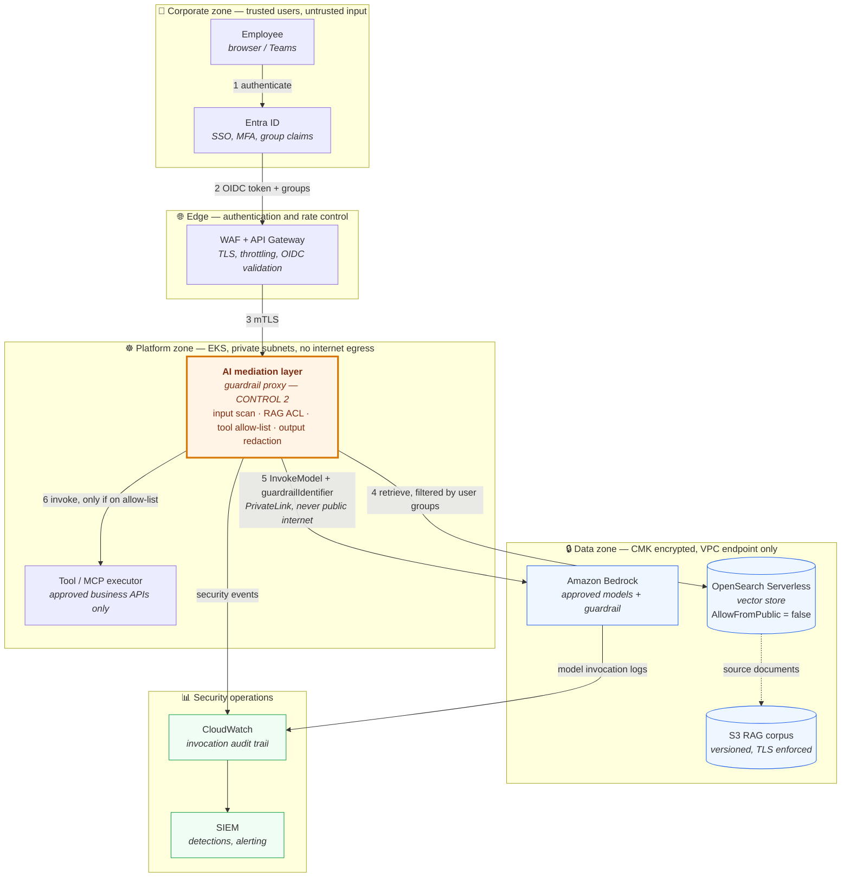
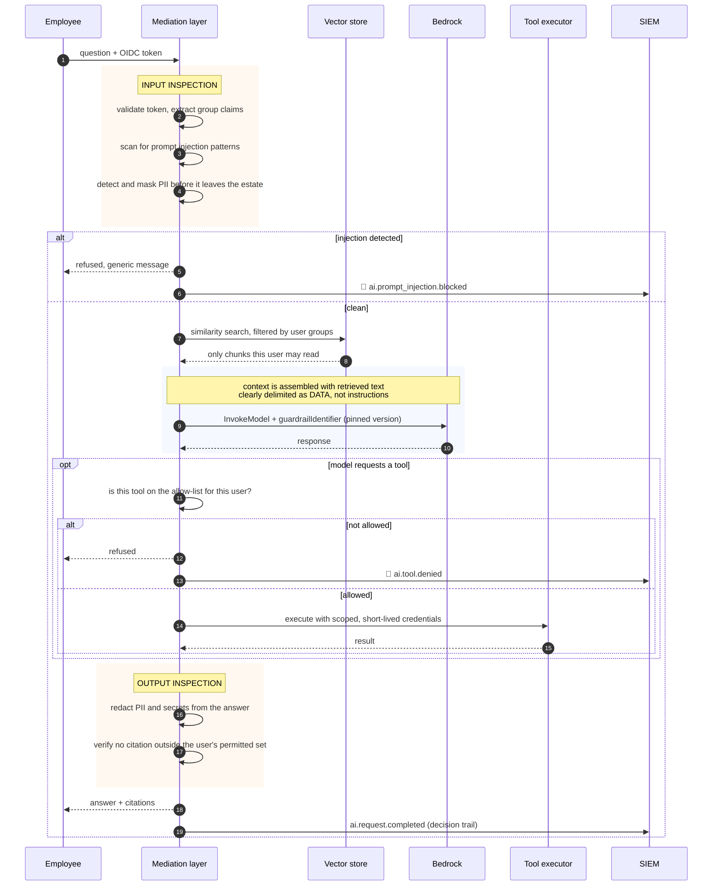
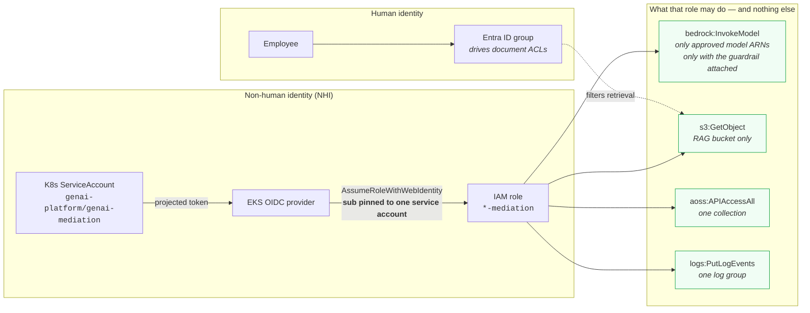

# Architecture

Secure enterprise GenAI assistant on AWS Bedrock and EKS.

All three diagrams below are backed by the Terraform module in
`controls/terraform/`, so the picture and the code cannot drift apart. Resource
names in the notes refer to real addresses in that module.

---

## 1. Platform overview

The main diagram. Four trust boundaries, one direction of travel: a request
crosses each boundary only through a single mediated chokepoint.

**Why the shape is this shape**

| Decision | Reason |
|---|---|
| One mediation layer, no direct model access | A single chokepoint is the only place a guardrail can be enforced consistently. Anything that bypasses it still meets the server-side Bedrock guardrail — defence in depth, not a single wall. |
| Data zone has no route to the internet | Inference and retrieval traffic uses VPC endpoints (`aws_vpc_endpoint.bedrock_runtime`, `aws_vpc_endpoint.s3`). There is no NAT gateway, so an exfiltration attempt has no network path. |
| Retrieval is filtered *before* the model sees it | The model cannot keep a secret it was never given. Document-level ACL enforcement at step 4 is stronger than asking the model to withhold an answer at step 5. |
| Tool execution is separated from the proxy | The component that decides *whether* a tool may run is not the component that runs it. |

---

## 2. Zoom-in — the request path through the guardrail

Where Control 2 sits, and what happens to a malicious request. Every numbered
decision is a deny point.

**The key insight in this diagram**

Retrieved document text is inserted into the prompt as *data*, never as
instructions. This is the structural answer to prompt injection: the attack
works by making the model mistake content for commands, so the mitigation is to
mark the boundary explicitly and to filter at retrieval time — not to ask the
model politely to ignore it.

---

## 3. Zoom-in — identity and permissions

No static credentials exist anywhere in this design. Each arrow is a trust
relationship that can be revoked independently.

**Two details that matter under questioning**

1. **The trust policy pins one service account.** `StringEquals` on the `sub`
   claim, matching exactly
   `system:serviceaccount:genai-platform:genai-mediation`. A `StringLike` with a
   wildcard here would let *any* pod in the cluster assume the role and read the
   entire document corpus. The policy gate in `controls/policy/iam.rego` rejects
   that pattern, and the insecure fixture proves it fires.

2. **The model allow-list is enforced twice.** Once in the IAM policy, and again
   in the VPC endpoint policy. A pod that somehow obtained broader IAM
   permissions still cannot reach an unapproved model from inside this VPC.

---

## Assumptions

- Entra ID is the enterprise IdP and already issues group claims usable for
  document-level authorisation.
- The EKS cluster, VPC, subnets and node security group exist and are managed
  outside this module; they are passed in as variables.
- Synthetic values are used for all account IDs, VPC IDs and subnet IDs.
- `eu-central-1` is the designated region for EU data residency.

## Limitations

- Nothing here is deployed. The design is validated offline against the rendered
  Terraform plan; it has not been applied to a live AWS account.
- IRSA token exchange cannot be tested without a real OIDC provider and STS. The
  trust policy *document* is validated by policy-as-code; the runtime exchange is
  not.
- Azure AI Foundry is not drawn. The same structure maps onto it — Entra ID
  workload identity in place of IRSA, Private Link in place of VPC endpoints,
  Azure Policy in place of the OPA gate.
