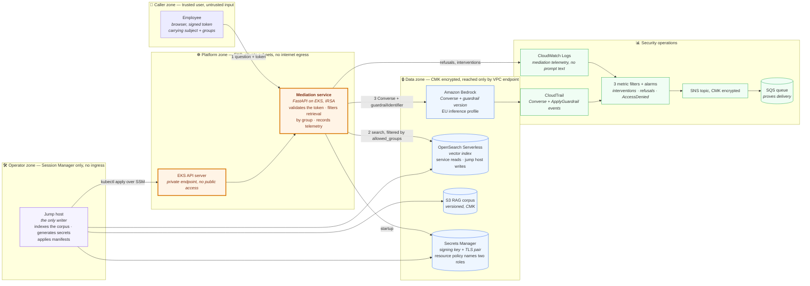
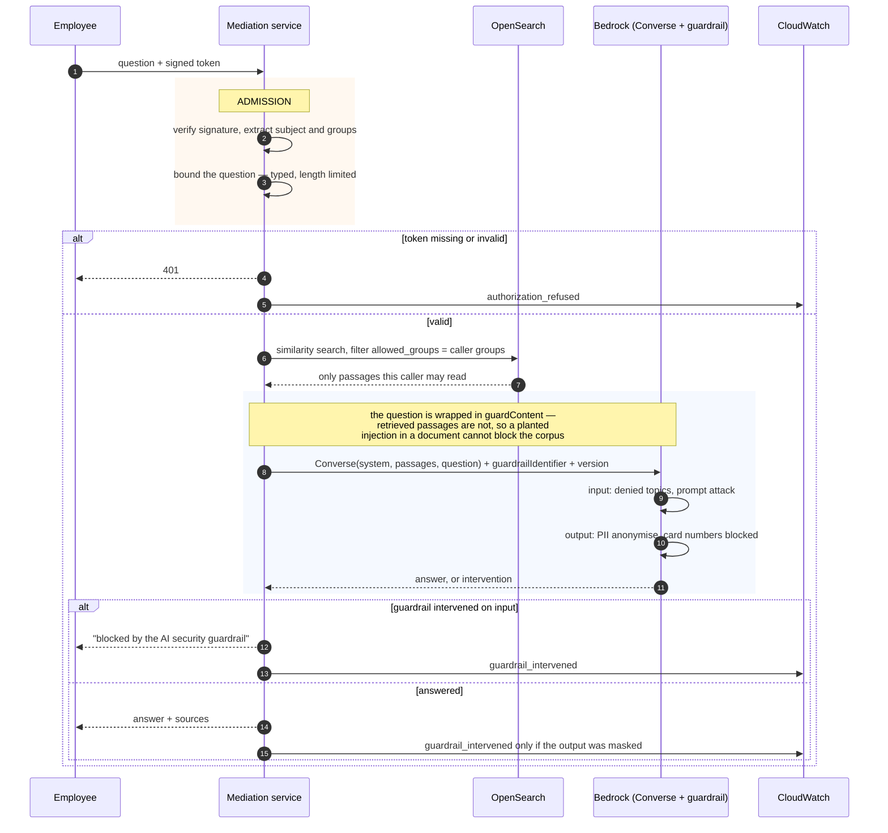
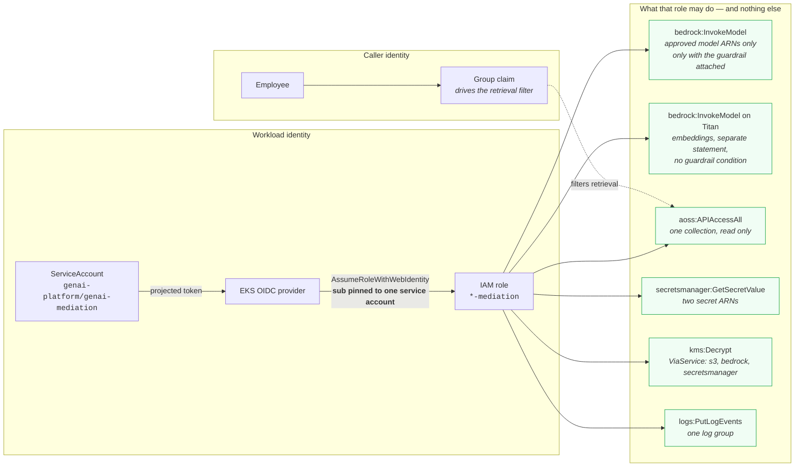

# Architecture

Secure enterprise GenAI assistant on AWS Bedrock and EKS.

Every component below is deployed in account `891377211626`, `eu-central-1`, and
backed by Terraform in `controls/terraform/`. Anything designed but not built is
listed at the end rather than drawn, so the picture cannot claim more than the
account contains.

---

## 1. Platform overview

Four trust boundaries. A request crosses each one through a single mediated
chokepoint, and no boundary is crossed by the model's own judgement.

**Why the shape is this shape**

| Decision | Reason |
|---|---|
| One mediation service, no direct model access | A single chokepoint is the only place entitlement can be enforced consistently. Anything reaching Bedrock another way still meets the server-side guardrail — defence in depth, not a single wall. |
| Retrieval is filtered *before* the model sees it | The model cannot leak a passage it was never given. The filter is a `terms` clause on `allowed_groups` inside the search query, not a post-hoc check on the answer. |
| The service reads the index and never writes it | The OpenSearch data access policy grants writes to the jump host role alone, so corpus poisoning by prompt injection is impossible rather than unlikely — the identity running the injection has no write permission to use. |
| No NAT gateway, no internet gateway, no SSH | Every AWS call leaves through a VPC endpoint; the only way in is Session Manager, which dials out. An exfiltration attempt has no network path. |
| The audit trail carries no prompt text | CloudTrail records the call and the guardrail evaluation, not the content. Replay of what was asked is lost deliberately; a log full of prompts is a second copy of the data the guardrail exists to protect. |

---

## 2. The request path

Every numbered step is a place the request can be refused. The guardrail is
evaluated twice by Bedrock — once on the question, once on the answer.

**Three things to say about this diagram under questioning**

1. **`Converse`, not `InvokeModel`.** With `InvokeModel` and the Anthropic
   Messages body, Bedrock ignores the `guardContent` tags entirely: the trace
   returns with every policy unit at zero and `guardrailAction: NONE`, while the
   model's own refusal makes it look like the control worked. The same text
   through `ApplyGuardrail` comes back `BLOCKED` at HIGH confidence — that
   difference is how a misconfigured guardrail is told apart from an unapplied
   one.

2. **Only the question is wrapped.** The `guardContent` block scopes the scan
   rather than enabling it. One corpus document is a planted injection; scanning
   quoted passages would block the corpus instead of the caller.

3. **An anonymisation is an intervention.** A masked answer and a blocked
   request both set `guardrail_intervened`, so the flag alone does not separate
   them — the answer body does.

---

## 3. Identity and permissions

No static credential exists anywhere in this design. Each arrow is a trust
relationship that can be revoked on its own.

**Four details that matter under questioning**

1. **The trust policy pins one service account.** `StringEquals` on the `sub`
   claim, matching `system:serviceaccount:genai-platform:genai-mediation`
   exactly. A `StringLike` wildcard would let any pod in the cluster assume the
   role and read the corpus. `controls/policy/iam.rego` rejects that pattern and
   the insecure fixture proves the rule fires.

2. **Embeddings need their own statement.** The model grant is conditioned on
   `bedrock:GuardrailIdentifier`; an embedding call carries no guardrail, so
   that condition could never match and the workload could not embed at all.
   Found only by asking a real question.

3. **The model allow-list is enforced twice.** Once in IAM, once in the Bedrock
   VPC endpoint policy. A pod that somehow acquired broader IAM permissions
   still cannot reach an unapproved model from inside this VPC. The endpoint
   pins which model, with a wildcard region; which regions are permitted stays
   in IAM, where the account evaluates it.

4. **Anthropic models are reachable only through an inference profile**, and the
   EU profile routes to six regions — so IAM authorises the
   `inference-profile/` ARN in this account and the `foundation-model/` ARN in
   each of those six. Authorising only the profile produces an AccessDenied that
   names the model ARN and explains nothing.

---

## Designed, not deployed

Drawn nowhere above, because the account does not contain them:

- **Corporate IdP.** In production the token comes from Entra ID with group
  claims. Here the same key signs tokens minted for `alice` and `dana` inside
  the pod, so the authorisation logic is real and the identity source is not.
- **WAF and API Gateway.** There is no public entry point at all; the front end
  is reached through Session Manager and a port-forward.
- **SIEM.** Both streams are CloudWatch log groups, so the seam is a
  subscription filter to Firehose or a cross-account destination. Neither the
  filter nor a destination is written; nothing subscribes today.
- **Tools.** The assistant calls none. It retrieves and it answers.

## Assumptions

- Group names match on both sides — the token's claim and the document's
  `Audience:` header. There is no registry; a typo in either yields zero
  matches.
- `eu-central-1` is the designated region for EU data residency, and the EU
  inference profile's six regions are all inside the EU.
- All sample data is synthetic.

## Limitations

- **The alarms name the metric, not the identity.** A CloudWatch alarm binds to
  one metric, so interventions are summed across every caller.
- **The guardrail runs on the default content-filter tier** (Classic), by
  default rather than by decision.
- **IRSA, EKS access entries and etcd envelope encryption are proven only by
  running the platform**, which this deployment does — but they cannot be
  demonstrated without an account.
